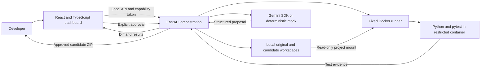
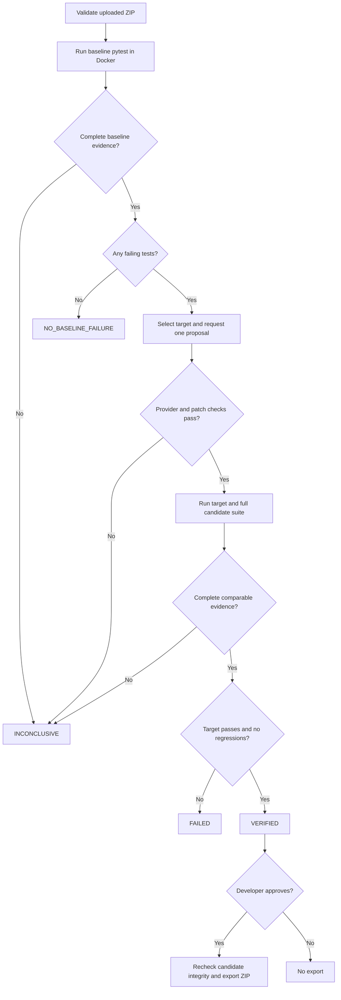

# DevPilot AI

**A verification-first debugging assistant for small Python projects.**

AI-generated fixes are easy to suggest and harder to trust. DevPilot accepts a Python project ZIP, reproduces its pytest failure in Docker, requests a focused Gemini patch, and compares baseline and candidate results. Developers review the explanation, diff and test evidence before approving a patched ZIP.

**AI proposes. Deterministic validation verifies. The developer approves.**

Built with **React, TypeScript, FastAPI, Gemini, Docker and pytest**. Scope: a local development MVP for standard-library Python projects with ordinary pytest tests, one source-file replacement and one proposal per analysis. Mock AI is enabled by default; live requests require explicit configuration and a failing baseline.

[Windows setup](#installation-on-windows) · [Validation evidence](docs/VALIDATION.md) · [Two-minute demo](docs/DEMO_GUIDE.md) · [Project showcase](docs/PROJECT_SHOWCASE.md) · [Security audit](docs/SECURITY_AUDIT.md)

## Verified results

| Evidence | Result and provenance |
| --- | --- |
| Final security-audit backend suite | **109 passed, 3 Docker tests skipped**; recorded in the [audit](docs/SECURITY_AUDIT.md#verification) |
| Subsequent Docker regression run | **3 integration tests passed**, confirmed by the maintainer after the audit |
| Original discount, off-by-one and sorting benchmarks | All three verified using **mock-generated patches and real Docker execution** |
| Live Gemini discount fix | A genuine Gemini-generated fix was verified, confirmed by the maintainer |
| Unseen time-window consolidation bug | Fixed with live Gemini and independently evaluated, as reported by the maintainer |

These are individual checks and demonstrations, **not a statistical success rate over a representative dataset**. The unseen fixture and its evaluation artifacts are not bundled in this checkout. No application tests or live Gemini calls were repeated for this documentation update; [the validation record](docs/VALIDATION.md) explains the evidence boundaries.

## Features

- Bounded ZIP validation, temporary isolated originals and candidates, and session capability tokens.
- Docker-only pytest execution with CPU, memory, process, time and output limits.
- One structured Gemini proposal per analysis, or a clearly labeled deterministic mock proposal.
- One-file patch validation, AST parsing, import restrictions, and a unified diff.
- Targeted and full-suite verification with explicit failed and inconclusive outcomes.
- Responsive dark dashboard, live backend progress, collapsible logs, approval and ZIP export.
- Three intentionally broken projects and fast mocked tests; opt-in real Docker benchmark tests.

## Architecture



The API keeps the Gemini key on the backend. Uploaded code executes only in Docker; the model returns structured data, never executable tool commands. Originals and disposable candidates are stored separately. The provider is instructed to treat project content as untrusted data; that instruction is supplemented by local schema and patch checks.

### Debugging workflow



The server chooses the first failing test ID in sorted order and sends bounded context for one replacement. `VERIFIED` means the target improved without detected regressions; other original failures may remain. Full-suite success is reported separately.

## Stack

| Layer | Implementation |
| --- | --- |
| UI | React, Vite, TypeScript, Tailwind CSS, Lucide, native fetch |
| API | Python, FastAPI, Pydantic, Uvicorn |
| AI | Official `google-genai` SDK; configurable Gemini model |
| Tests | Fixed Python 3.12 / pytest 8.4.2 Docker image |
| Persistence | In-memory session records plus local JSON results and workspaces |

## Prerequisites

Windows PowerShell, Python 3.11+, Node.js 22+ with npm, and Docker Desktop running **Linux containers**. Git is useful for publishing the source. No cloud infrastructure is required.

Official installers: [Python](https://www.python.org/downloads/windows/), [Node.js](https://nodejs.org/en/download), [Docker Desktop](https://docs.docker.com/desktop/setup/install/windows-install/), [Git](https://git-scm.com/downloads/win).

Check tools before installing duplicates:

```powershell
python --version
node --version
npm.cmd --version
docker info --format '{{.OSType}}'
git --version
```

`npm.cmd` avoids PowerShell execution-policy restrictions on `npm.ps1`. Virtual-environment activation is optional; the commands below call its Python directly.

## Installation on Windows

Run from your checkout directory (replace the example path with your own):

```powershell
Set-Location 'C:\path\to\devpilot-ai'
python -m venv backend/.venv
backend/.venv/Scripts/python.exe -m pip install -r backend/requirements.txt
if (-not (Test-Path .env)) { Copy-Item .env.example .env }
Set-Location frontend
npm.cmd ci
Set-Location ..
```

Do not overwrite an existing `.env`. The frontend lockfile records the installed dependency tree. `backend/requirements.lock.txt` captures the tested Python environment; `requirements.txt` declares compatible direct ranges.

### Docker setup

Start Docker Desktop, select Linux containers, and wait until `docker info` succeeds. Then build the fixed runner:

```powershell
docker build -t devpilot-runner:local ./sandbox
```

The image build downloads Python and pytest. Analysis never pulls images or installs uploaded requirements. If the image is missing, build it before trying again.

### Backend

In terminal 1, from the repository root:

```powershell
backend/.venv/Scripts/python.exe -m uvicorn app.main:app --app-dir backend --host 127.0.0.1 --port 8000
```

Use one worker for this in-memory MVP. `GET http://127.0.0.1:8000/api/health` reports Docker connectivity and AI configuration readiness. Readiness does not probe Gemini account access or confirm that the runner image is built. Development API documentation is at `/docs`; `DEVELOPMENT=false` disables it.

### Frontend

In terminal 2:

```powershell
Set-Location 'C:\path\to\devpilot-ai\frontend'
npm.cmd run dev
```

Open **http://127.0.0.1:5173**. Vite proxies `/api` to the localhost backend. Both servers bind to loopback by default.

## Gemini configuration

Edit the root `.env` manually. Never put a key in the frontend or a `VITE_` variable:

```dotenv
GEMINI_API_KEY=your-key-here
GEMINI_MODEL=gemini-3.6-flash
DEV_MODE_MOCK_AI=false
```

Restart the backend after changing configuration. Obtain a key through [Google AI Studio](https://aistudio.google.com/apikey). `gemini-3.6-flash` is this repository's configured default; account access and model availability are separate from local readiness. Root `.env` loading uses an absolute path and works regardless of the working directory. Existing process environment variables take precedence.

The official `google-genai` SDK uses the Gemini Developer API `v1beta` endpoint and `response_json_schema`. Requests have a 15-second network-operation timeout, a 40-second cancellable total deadline, one attempt, no automatic retries or function calls, and a 6,000-token output limit. Strict Pydantic and patch validation run locally. Overall analysis time also includes Docker runs; this is not a latency benchmark.

HTTP 400, 401, 403, 404 and 429, network failures and timeouts have distinct sanitized diagnostics. Raw provider responses and credentials are excluded from those messages. No automatic model fallback or live startup probe is performed.

Only enable real AI for code you intend to send to Google: bounded source, target test text, repository paths and sanitized failure logs leave your machine in live mode. Sanitization is not a general-purpose secret scanner.

### Mock mode

```dotenv
DEV_MODE_MOCK_AI=true
```

No API key is needed. Mock proposals recognize only the three included benchmark patterns. Both UI and API label them **MOCK**. Docker still executes real tests during an interactive mock-mode analysis. Unit tests separately mock the Docker adapter; those test results do not demonstrate real sandbox execution.

## Try the benchmarks

From the repository root:

```powershell
Compress-Archive -Path .\benchmarks\discount_bug\* -DestinationPath .\discount_bug.zip -Force
Compress-Archive -Path .\benchmarks\off_by_one_bug\* -DestinationPath .\off_by_one_bug.zip -Force
Compress-Archive -Path .\benchmarks\sorting_bug\* -DestinationPath .\sorting_bug.zip -Force
```

Upload one ZIP, select **Analyze project**, inspect the diagnosis and test evidence, then approve a verified patch to unlock download. Rejecting a patch disables export. Original uploads are preserved unchanged.

| Benchmark | Intentional defect | Expected replacement |
| --- | --- | --- |
| Discount | Treats a percentage as a fraction | Divide percentage by 100 |
| Off-by-one | Excludes the inclusive upper bound | Use `range(1, n + 1)` |
| Sorting | Sorts in descending order | Remove `reverse=True` |

The three opt-in Docker tests explicitly use mock AI and require both `VERIFIED` and full-suite success. The separate live Gemini demonstrations are recorded in [VALIDATION.md](docs/VALIDATION.md); they are not covered by those mock benchmark assertions.

## Project input contract

Defaults: 5 MB compressed, 20 MB extracted, 256 KB per file, 100 archive entries, maximum compression ratio 200:1. Size and count limits are configurable in [.env.example](.env.example); the compression ratio is fixed in code.

Accepted: UTF-8 `.py` files plus `README.md`, `README.txt`, `LICENSE`, `requirements.txt`, and `pyproject.toml`. Hidden paths, binaries, encrypted archives, links, special files, duplicates, unsafe Windows filenames, traversal paths and common sensitive filenames are rejected. Python source must parse as AST. A single wrapping directory is removed automatically.

Use ordinary `test_*.py` / `*_test.py` pytest tests and simple imports from the project root. Uploaded pytest configuration is ignored; `conftest.py`, plugin autoload and third-party dependencies are disabled. Metadata is retained for export but never installed. Tests that need extra dependencies, custom fixtures in conftest, writable source files or nonstandard layouts may be inconclusive. Runtime temporary files belong in pytest `tmp_path` or `/tmp`.

## API

| Method and path | Behavior |
| --- | --- |
| `GET /api/health` | Local service readiness; no account API call |
| `POST /api/projects/upload` | Raw ZIP body, `Content-Type: application/zip`, `X-Filename: example.zip`; returns project and capability |
| `POST /api/projects/{id}/analyze` | Starts one background attempt; returns 202 |
| `GET /api/projects/{id}/results` | Current phase, evidence and results |
| `POST /api/projects/{id}/approve` | JSON `{"approve": true}` or `false` |
| `GET /api/projects/{id}/download` | Approved verified candidate ZIP |

All project-specific routes require `Authorization: Bearer <capability_token>`. Tokens expire after two hours by default and are held only in React memory, never localStorage or URLs. Result JSON on disk contains no token. A browser refresh loses access; a backend restart resets the in-memory registry. Recent history and metrics reflect the current session's actual backend records. Upload/analyze limits are six/four requests per client per minute, with one active analysis globally and at most 40 projects per server session.

## Verification philosophy

| Status | Meaning |
| --- | --- |
| `VERIFIED` | The previously failing target passes in both targeted and full runs; collection is unchanged; passing tests remain passing; no new failures |
| `FAILED` | Completed evidence shows the target still fails or a regression occurred |
| `INCONCLUSIVE` | Missing Docker, invalid patch, provider failure, no tests, collection error, timeout, missing/changed evidence, or another required check could not complete |
| `NO_BASELINE_FAILURE` | A complete baseline has no failing tests, so no proposal is requested |

`full_suite_success` is separate from verified improvement: another original failure may remain after the target is fixed. Skipped tests are never counted as passing. Model confidence is displayed only as schema data and has no influence on status. `PENDING` is the nonterminal state while work proceeds.

## Security architecture

- Fixed argument-array Docker invocation; no shell execution, host execution of uploaded Python, LLM commands, privileged mode, Docker socket mounts or host secret mounts.
- Non-root UID 10001, no network, one CPU, 256 MB memory/swap limit, 64 PIDs, all capabilities dropped, no privilege escalation, read-only root/project, 64 MB controlled tmpfs.
- Default 45-second execution timeout; force-remove the container on completion or timeout. Capture at most 256 KB of output and retain bounded technical logs. Docker Desktop daemon/cleanup failure can still require manual container inspection.
- Patch one existing allowlisted non-test source file. Reject hidden/configuration/test targets, new imports, new dynamic execution calls, ambiguous replacements and syntax errors. This conservative AST policy is not a proof of arbitrary Python semantics or a comprehensive malicious-code detector.
- Candidate tree integrity uses length-prefixed paths and contents; export is built from the exact byte snapshot that passed the check. The full original is kept separately.
- Test evidence requires one final report frame with unique JSON keys, consistent process status and complete test collection. Ambiguous or incomplete evidence is inconclusive; these checks do not authenticate malicious pytest code.
- Bounded request bodies before parsing, explicit origin/host checks, per-client limits and capability checks on project reads and writes.
- Startup cleanup removes expired generated workspace directories. Capability expiry immediately blocks API access; files are deleted on a subsequent startup cleanup.

**Docker hardening mitigates risk; it is insufficient for a public multi-tenant untrusted-code execution service.** The pytest process shares its interpreter with project code; deliberately malicious code can try to forge evidence. Verification is an engineering check on ordinary developer projects, not cryptographic attestation of adversarial tests. Dependencies and container/host vulnerabilities remain relevant. Do not expose this MVP to the internet. Public deployment requires real authentication/authorization, stronger execution isolation and evidence collection, persistent job management, audited quotas, secret scanning and an infrastructure security review. Capability tokens are not full multi-user authentication.

See the [targeted security audit](docs/SECURITY_AUDIT.md) for confirmed findings, applied fixes, test evidence and deferred issues, including malformed-DEFLATE upload cleanup and unconfirmed container cleanup when Docker fails.

## Tests and build

Fast tests use mocked AI and Docker responses; they do not execute uploaded code on the host:

```powershell
Set-Location 'C:\path\to\devpilot-ai\backend'
$env:RUN_DOCKER_TESTS = '0'
New-Item -ItemType Directory -Path .pytest_tmp -Force | Out-Null
$pytestTemp = Join-Path (Get-Location) ('.pytest_tmp\unit-' + [guid]::NewGuid().ToString('N'))
.venv/Scripts/python.exe -m pytest tests -q --tb=short --basetemp=$pytestTemp
Remove-Item Env:RUN_DOCKER_TESTS
Set-Location ..\frontend
npm.cmd run build
```

After starting Docker Desktop and building the runner, opt into actual container benchmarks (still no Gemini calls):

```powershell
Set-Location 'C:\path\to\devpilot-ai\backend'
$env:RUN_DOCKER_TESTS = '1'
New-Item -ItemType Directory -Path .pytest_tmp -Force | Out-Null
$pytestTemp = Join-Path (Get-Location) ('.pytest_tmp\docker-' + [guid]::NewGuid().ToString('N'))
.venv/Scripts/python.exe -m pytest tests/test_docker_integration.py -q --tb=short --basetemp=$pytestTemp
Remove-Item Env:RUN_DOCKER_TESTS
```

Each command creates a unique project-local pytest directory to avoid Windows system TEMP permission issues and preserve other test sessions. These directories are ignored by Git. Do not run pytest at the repository root: benchmark projects intentionally contain failing tests and are intended for Docker execution.

## Project structure

```text
backend/app/         API, configuration, ZIP security, workspaces,
                    Docker runner, AI provider, patching and verification
backend/tests/       Security, provider, API workflow and optional Docker tests
frontend/src/        React dashboard, results, API client, types and styles
sandbox/            Fixed Docker image and pytest evidence entry point
benchmarks/         Three intentionally broken Python projects
docs/               Validation, security audit, demo and portfolio guides
.env.example        Backend configuration placeholders
```

## Troubleshooting

| Symptom | Action |
| --- | --- |
| Sandbox unavailable | Start Docker Desktop with Linux containers; confirm `docker info` |
| Sandbox could not start | Build `devpilot-runner:local`; check Docker file-sharing access to this workspace |
| `npm.ps1` cannot be loaded | Use `npm.cmd`; no execution-policy change needed |
| Backend unavailable | Start Uvicorn on port 8000; leave its terminal running |
| No tests collected | Include `test_*.py` with ordinary pytest functions |
| Collection errors | Check expanded logs; remove dependency/configuration assumptions |
| Model unavailable / denied | Set an account-supported `GEMINI_MODEL`; check key access; restart backend |
| Token expired / refresh lost session | Upload the ZIP again; tokens cannot be recovered |
| Another analysis is running | Wait for the current analysis; duplicate attempts are intentionally blocked |
| Unsupported mock project | Use a bundled benchmark or configure live Gemini |

## Screenshots

No authentic screenshot files currently exist under `docs/`, so no screenshot images are embedded. The [capture checklist](docs/SCREENSHOTS.md) covers all eight presentation views and publication checks. The [90–120-second demo guide](docs/DEMO_GUIDE.md) provides a recording script; no recording is included or claimed.

## Current limitations and roadmap

Current scope is one source-file replacement, one attempt, standard-library Python plus pytest, session-lifetime browser history, and one concurrent analysis. The fixed image is configured by a local tag rather than a distributed digest. No production deployment, real multi-user identity, dependency installation, persistent queue or browser automation suite is included.

Future work: stronger isolation and tamper-resistant evidence, a curated dependency image catalog, persistent authenticated history, expanded test-layout support, and narrowly bounded multi-file patches. These are not implemented features.
